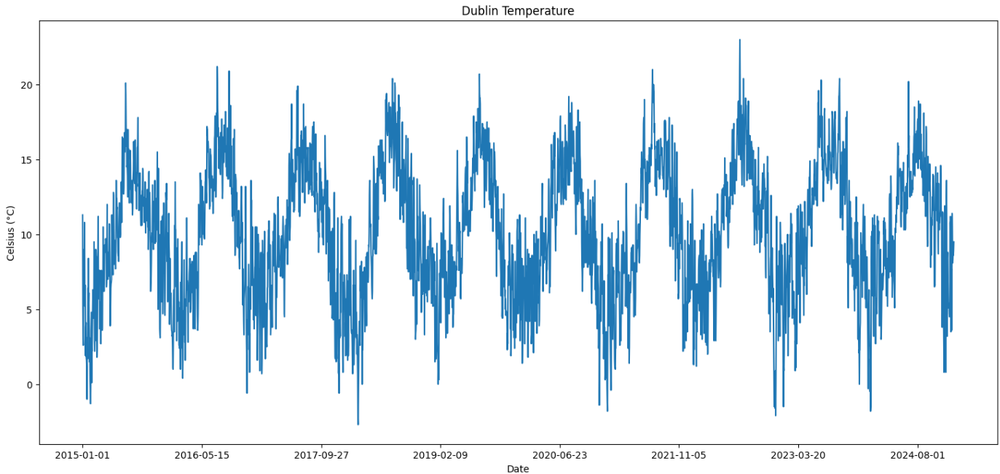
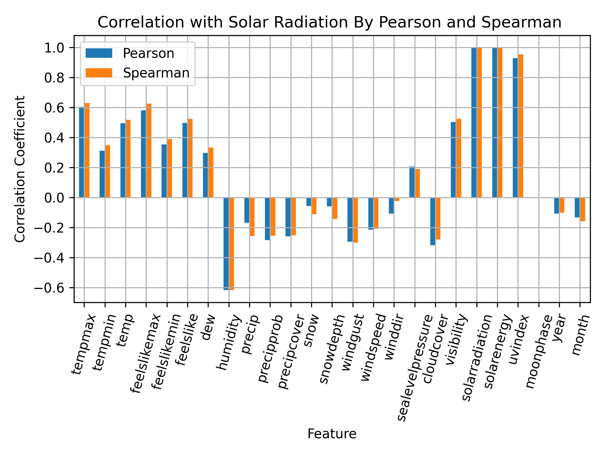
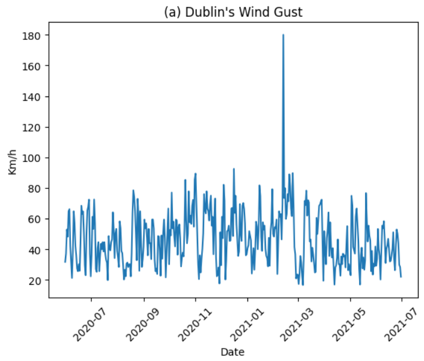
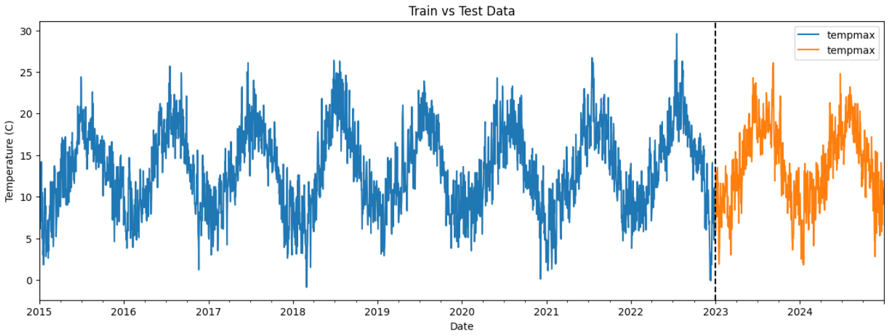
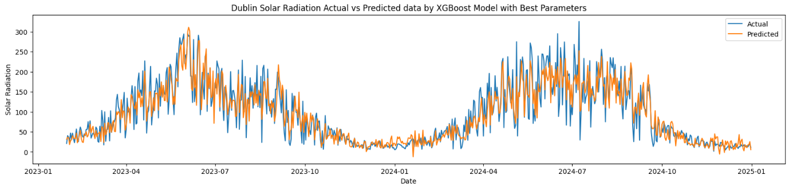
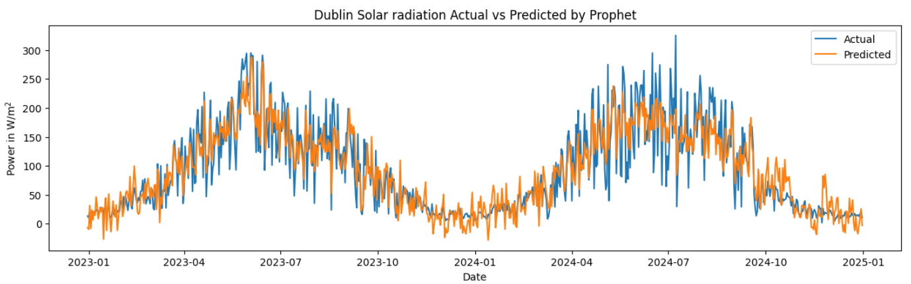
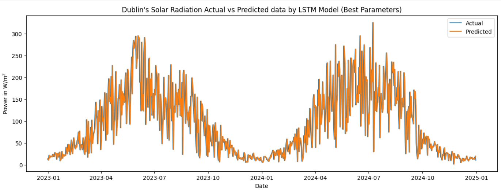

# Solar-Radiation-Forecasting
This study compares three time-series forecasting paradigms—statistical, machine learning, and deep learning—using ten-years of historical weather data from Dublin. The objective is to evaluate the performance of Prophet, XGBoost, and LSTM when forecasting daily solar radiation under multiple preprocessing strategies. 

# Abstract
An extensive data analysis was conducted, including descriptive statistics, inferential testing, stationarity assessment, outlier detection, feature selection, and exploratory visualisation. These steps revealed strong annual seasonality, nonlinear feature relationships, and variability across meteorological variables, informing the modelling framework and feature-engineering decisions. Four experiments were conducted using cleaned data, differenced data, log-transformed data, and cross-validation. Results show that XGBoost achieved the highest overall accuracy, particularly with the cleaned and log-transformed datasets. Prophet delivered stable, and robust performance, ending in second place. LSTM underperformed relative to the other models, likely due to dataset size and short-term variability. The findings highlight that in data-restricted, highly seasonal environments, statistical and machine learning models outperform deep learning algorithms.

## Objectives
- Clean and preprocess time-series data
- Handle missing values and outliers
- Descriptive statistics
- Feature relationship
- Inferential statistics
- Train and compare Prophet, XGBoost, and LSTM models

## Experimental desing for evaluation

- Experiment 1: Baseline models with clean dataset
In the first experiment, all three models were developed and fine-tuned using the dataset obtained after Exploratory Data Analysis (EDA) and cleaning. No transformations were applied to the target variable (solar radiation).

- Experiment 2: Differenced target variable
The second experiment evaluates how differencing the target feature affects model performance.
First-order differencing was applied to solar radiation to remove long-term trends and reduce non-stationarity.

- Experiment 3: Log-transformed target variable
The third experiment investigates the effects of stabilising variance through a log transformation. Each model was trained on the log-transformed target and results were later inverted for evaluation.

- Experiment 4: Cross-validation using clean dataset
Cross-validation was used as an experimental procedure during model training. The evaluation consisted of computing the average of statistical performance metrics across all validation folds for the forecasting task.

- Experiment 5: 30-day forecasting ahead
Following the evaluation of Prophet, XGBoost, and LSTM models, the most accurate forecasting framework was selected based on the results of Experiments 1 to 4. These final architectures were then retrained using the full ten-year dataset, enabling each model to exploit all available information before generating the short-term forecast.

# Data Preparation
Data preparation included quality assessment, missing-value handling, outlier screening, exploratory
analysis, and feature selection.
The analysis identified strong annual seasonality in solar radiation as Figure 1 illustrates.
Meteorological variables such as temperature, humidity, cloud cover, and wind-related measurements
were considered as potential predictors.

Figure 1: showing a Dublin’s temperature time series. Strong seasonality is observed.

Variables with strong correlation or potential information leakage were excluded where appropriate, as observed in Figure 2. Solar energy and UV index were not used as predictors because of
their strong relationship with solar radiation.

Figure 2: correlation between features and solar radiation. Strong relationship is observed across
’solar energy’ and ’UV index’.

Physically implausible observations were examined using statistical screening and domain
validation, observe Figure 3. Genuine weather extremes were retained, while implausible observations were corrected where justified.

Figure 3: implausible observation in Dublin’s wind gust feature.

The data were divided chronologically, with the oldest 80% used for model training and the
most recent 20% used for testing, as illustrated in Figure 4.

Figure 4: split on the data. The fist chronologically 80% is intended for training the models, whilethe 20% resting data will be used for testing purposes.

# Forecasting Models
## Prophet
Prophet was used as the representative statistical forecasting model. The selected primary configuration used linear growth, additive seasonality, yearly seasonality of 16 Fourier terms, weeklyseasonality of 5 Fourier terms, and tuned changepoint and prior-scale parameters.
## XGBoost
XGBoost was used as the representative machine learning model. The model incorporated temporal
and meteorological predictors. Hyperparameter optimisation was performed using randomized
search. The selected primary configuration included 1317 estimators, maximum depth of 3, learning
rate of approximately 0.0242, and tuned subsampling and column-sampling parameters.
## Long Short-Term Memory
LSTM was used as the deep learning model. The network learned sequential relationships from
scaled input sequences. The selected primary configuration used 96 recurrent units, a learning rateof 0.003, and a dense layer containing 32 units. Early stopping was used during training.

# Visualisation Results

Figure 5: Forecast vs Actual data by XGBoost Model.

Figure 6: Forecast vs Actual data by Prophet Model

Figure 7: Forecast vs Actual data by LSTM Model.

# Conclusion
This study compared Prophet, XGBoost, and LSTM for daily solar radiation forecasting using ten
years of meteorological data from Dublin, Ireland. XGBoost achieved the strongest performance,
Prophet produced competitive results, and LSTM performed less effectively.
The findings demonstrate that a more complex deep learning architecture does not necessarily
provide superior forecasting accuracy for a moderate-sized, strongly seasonal meteorological dataset.
The results support systematic model comparison and careful feature engineering when selecting
forecasting approaches for solar-resource applications.
